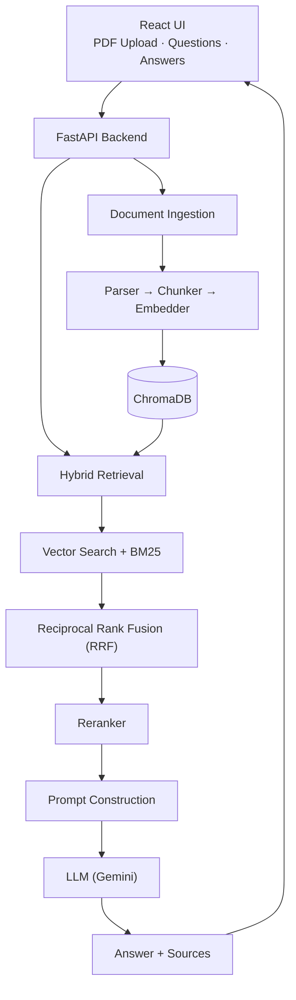

# Reader — Document RAG System

A document question-answering system built using **Retrieval-Augmented Generation (RAG)**.

Reader allows users to upload PDFs and ask questions about their contents. It retrieves relevant passages using hybrid search, reranks them, and generates answers using an LLM.

**Tech Stack:** React · FastAPI · ChromaDB · BM25 · Gemini

---

## Overview

```text
PDF
 ↓
Text Extraction
 ↓
Chunking & Embedding
 ↓
Vector Storage
 ↓
Hybrid Search (Vector + BM25)
 ↓
Reciprocal Rank Fusion (RRF)
 ↓
Reranking
 ↓
Prompt Construction
 ↓
LLM
 ↓
Answer + Sources
```

## Architecture



## Key Features

- PDF text extraction and chunking
- Semantic vector search using ChromaDB
- Keyword retrieval using BM25
- Hybrid retrieval with Reciprocal Rank Fusion
- Reranking for improved relevance
- LLM-generated answers with source passages


**Goal:** Build an end-to-end RAG system while understanding the retrieval, ranking, and generation components.